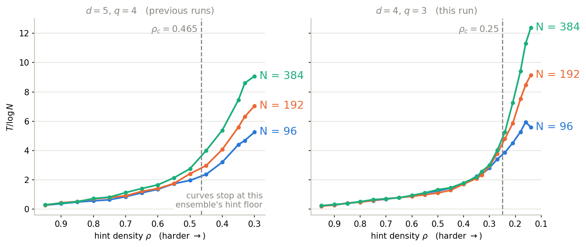
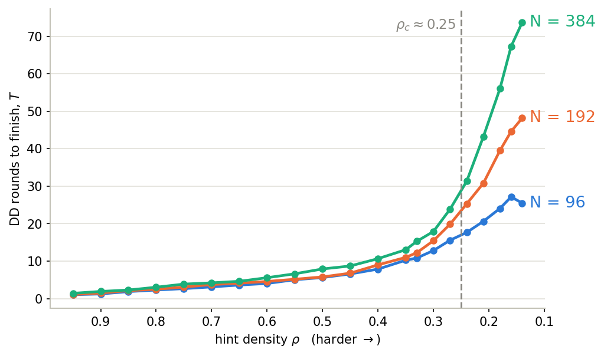
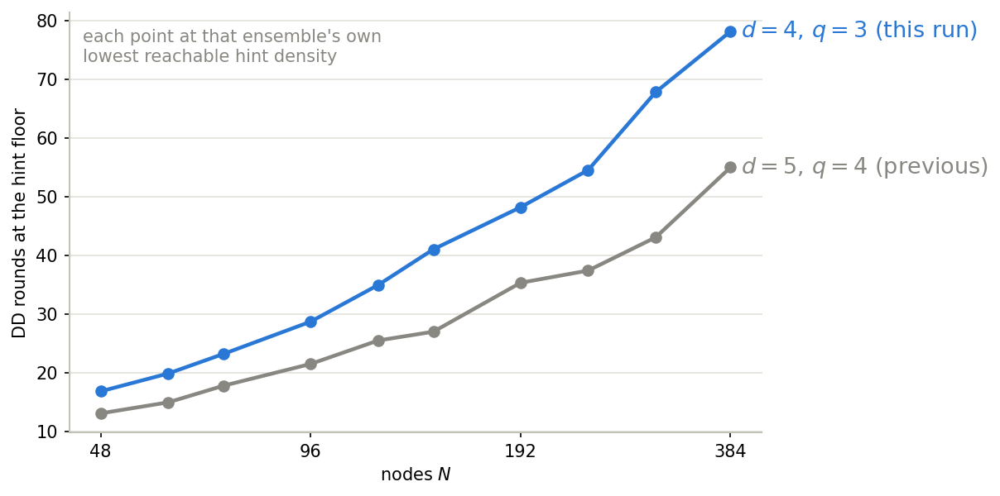
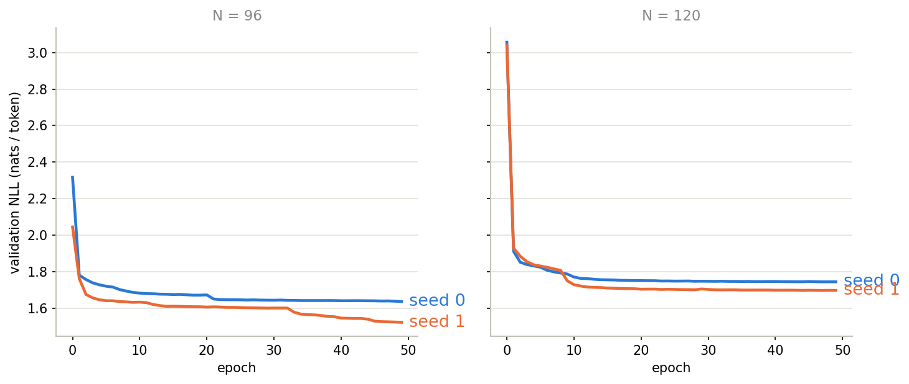
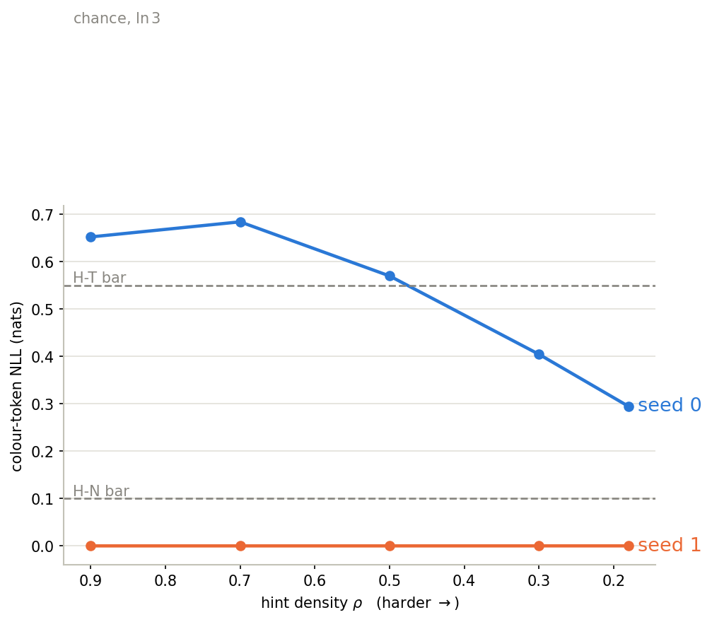
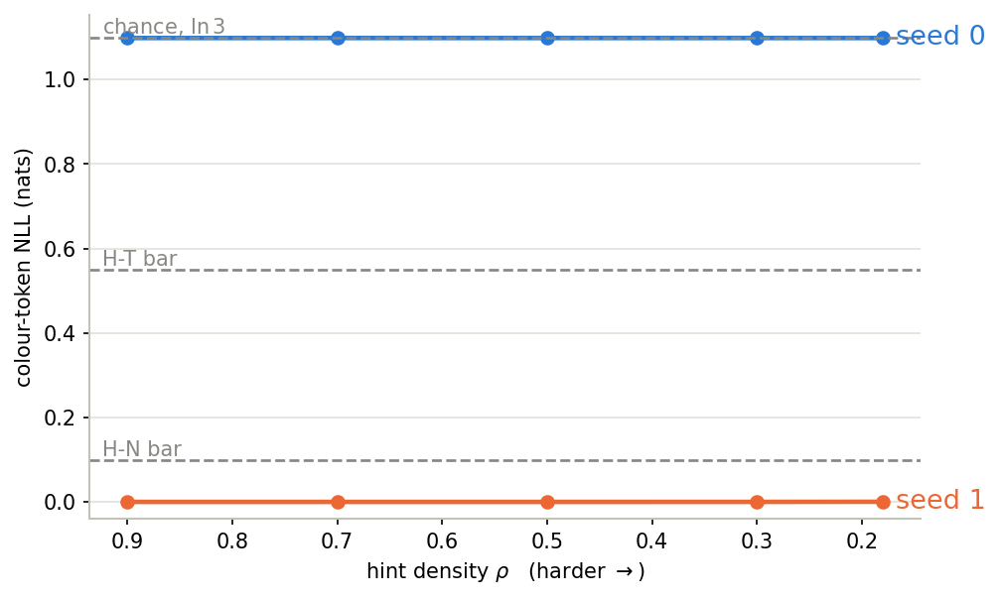
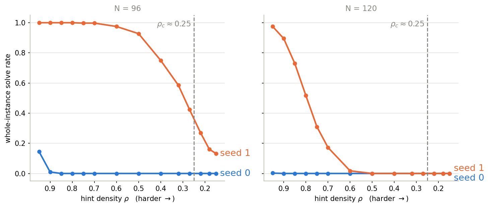
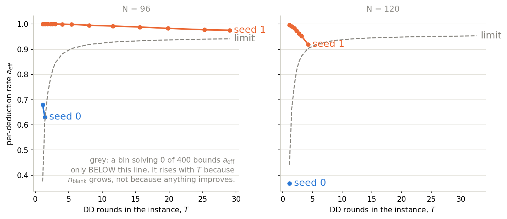

<!--
COMPLETE. Array 53243550 (4 cells) and the section split 53264789 (4 tasks)
all finished COMPLETED 0:0; the results pages below are scored against
runs/stagedq_2026-11-21/REGISTERED.md and its VERDICT.txt. This file is the
source of record in the PROJECT repo; the published copy lives at
~/slides/decks/spin-gnn/depth-lever/deck.md. Keep them in step by editing
here and copying forward, never the other way round.

No q=4 constant appears anywhere below. That is a rule of this stage, not a
style choice: a reader who sees a q=4 number on the same page as a q=3 number
will compare them, and those two ensembles have different chance levels,
different critical densities and different sequence lengths. Where a prior
q=4 result has to be described, it is described structurally (`at that
ensemble's own chance level`) and the numeral is withheld on purpose, with
the page saying so.
-->

# Does the colour head break because of size, or because of depth?

A transformer is trained to solve graph-colouring puzzles by writing out its
deductions one at a time. At the largest puzzle size we have tried, it stops
learning the colouring rule entirely. Two explanations fit every number we
have, and this run is built to tell them apart.

---

## The task: fill in a partly revealed colouring, one deduction at a time

We generate a graph whose nodes have already been validly coloured, hide most
of the colours, and ask the model to recover them. The model does not output
an answer in one shot. It writes a **reasoning trace**: a sequence of
`(node, colour)` steps, in a fixed order, until every hidden node is filled
in. Everything measured in this deck is measured on that trace.

---

## An instance is a random 4-regular graph with a planted 3-colouring

- **$d$-regular**: every node has exactly $d$ neighbours. Here $d = 4$.
- **$q$-colouring**: every node carries one of $q$ colours. Here $q = 3$.
- **Proper**: no edge joins two nodes of the same colour.
- **Planted**: we *first* choose a proper colouring, *then* keep only graphs
  consistent with it. So a valid answer is guaranteed to exist.

An instance is legal only if $q \mid N$ and $q(q-1) \mid dN$. At $d=4, q=3$
that reduces to $3 \mid N$.

---

## Hint density $\rho$ is the fraction of node colours we reveal

We reveal the colours of $\rho N$ nodes, chosen at random, and hide the rest.

$$n_{\text{blank}} = N - \mathrm{round}(\rho N)$$

is the number of nodes the model must deduce. High $\rho$ is an easy puzzle
with few blanks; low $\rho$ is a hard one. $\rho$ is the single knob that
moves an instance from easy to hard, and every evaluation below is a curve
over $\rho$.

---

## "Fall colouring" means every hidden node is reachable by deduction alone

A random subset of hints usually leaves nodes that **no** amount of local
reasoning can pin down — you would have to guess and backtrack. We do not
want to measure guessing, so hints are removed greedily and a removal is kept
only if the puzzle is still solvable by deduction alone. The surviving hint
set is the **fall colouring**. Every training and evaluation instance in this
project has this property.

It requires $d \ge q-1$, and it is the reason $\rho$ cannot be pushed
arbitrarily low: below some $\rho_{\min}$ no hint set works at all.

---

## Direct deduction fills a node when its neighbours exclude all but one colour

**Direct deduction (DD)**, also called naked-single elimination: look at one
node, list the colours already taken by its coloured neighbours, and if
exactly one colour survives, that colour is forced.

With $q = 3$, a node is forced as soon as two distinct colours appear among
its neighbours. No search, no guessing, no backtracking — DD either forces a
node or says nothing about it.

---

## A round applies DD to every node at once, and $T$ counts the rounds

One **round** evaluates DD at every still-blank node simultaneously, using
only the colours known at the *start* of the round, and fills in whichever
nodes were forced. Newly filled nodes then force more nodes in the next
round.

$T$ is the number of rounds needed to finish an instance. It is the **length
of the reasoning chain**: a node filled in round 7 depends on a node filled
in round 6, and so on back to the hints.

**$T$ is the quantity this whole run is about.** Call it the *DD depth*.

---

## The instance is serialised into one token sequence with four parts

1. `BEGIN_HINTS`, then each revealed node and its colour, as a pair.
2. `BEGIN_GRAPH`, then one row per node: the node, then its $d$ neighbours.
   Every undirected edge is therefore written **twice**, once in each
   endpoint's row.
3. `BEGIN_REASONING`, then for each round a `BEGIN_ROUND` marker followed by
   the forced `(node, colour)` pairs, sorted by node index.
4. A terminator, `SOLVED` or `UNRESOLVED`.

Neighbour order within a row is shuffled, so the model cannot read anything
off the ordering.

---

## The vocabulary has $N + 6 + q$ symbols and nothing else

| ids | meaning |
|---|---|
| 0–5 | `BEGIN_HINTS`, `BEGIN_GRAPH`, `BEGIN_REASONING`, `BEGIN_ROUND`, `SOLVED`, `UNRESOLVED` |
| 6 … 5+$q$ | `COLOR_0` … `COLOR_{q-1}` |
| 6+$q$ … | one id per node, `v0` … `v{N-1}` |

$$|V| = N + 6 + q$$

At $q=3$ the first node id is 9; at $q=4$ it would be 10. That one-symbol
shift is why every checkpoint is checked for
$|V| = N + 6 + 3$ before it is scored.

---

## A worked 12-node example: the graph and the colouring to recover

$N=12$, $d=4$, $q=3$, $\rho=0.5$. (The trained cells are $N=96$ and $N=120$;
this one is small enough to print.)

Planted colouring: `v0=2 v1=1 v2=1 v3=0 v4=0 v5=1 v6=1 v7=0 v8=2 v9=2 v10=0 v11=2`

Revealed: `v0=2 v3=0 v5=1 v6=1 v8=2 v9=2` — six of twelve.

| node | neighbours | | node | neighbours |
|---|---|---|---|---|
| v0 | v6 v7 v4 v3 | | v6 | v11 v3 v8 v0 |
| v1 | v7 v11 v9 v10 | | v7 | v5 v1 v2 v0 |
| v2 | v7 v3 v8 v4 | | v8 | v10 v2 v6 v4 |
| v3 | v6 v9 v0 v2 | | v9 | v5 v1 v3 v10 |
| v4 | v8 v2 v0 v11 | | v10 | v9 v1 v8 v5 |
| v5 | v10 v11 v9 v7 | | v11 | v5 v6 v4 v1 |

---

## The same example, solved: three rounds, six deductions

- **Round 1** — `v2←1`, `v7←0`, `v10←0`
- **Round 2** — `v1←1`, `v4←0`
- **Round 3** — `v11←2`

So $T = 3$ and $n_{\text{blank}} = 6$. Every deduced colour matches the
planted one, which is guaranteed: DD only ever writes a forced colour.

Read round 2 to see the chain: `v1` becomes forced only *because* `v7` and
`v10` were filled in round 1.

---

## The same example as the exact token stream the model reads

```
BEGIN_HINTS
  v0 COLOR_2  v3 COLOR_0  v5 COLOR_1  v6 COLOR_1  v8 COLOR_2  v9 COLOR_2
BEGIN_GRAPH
  v0 v6 v7 v4 v3   v1 v7 v11 v9 v10   v2 v7 v3 v8 v4   v3 v6 v9 v0 v2
  v4 v8 v2 v0 v11  v5 v10 v11 v9 v7   v6 v11 v3 v8 v0  v7 v5 v1 v2 v0
  v8 v10 v2 v6 v4  v9 v5 v1 v3 v10    v10 v9 v1 v8 v5  v11 v5 v6 v4 v1
BEGIN_REASONING
BEGIN_ROUND  v2 COLOR_1  v7 COLOR_0  v10 COLOR_0
BEGIN_ROUND  v1 COLOR_1  v4 COLOR_0
BEGIN_ROUND  v11 COLOR_2
SOLVED
```

The model sees only these ids. There is no grid, no picture and no colour
names — `COLOR_1` is just symbol 7.

---

## The sequence length is exactly $N(d+3) + T + 4$

$$L \;=\; \underbrace{1 + 2\rho N}_{\text{hints}} \;+\; \underbrace{1 + N(d+1)}_{\text{graph}} \;+\; \underbrace{1 + T + 2N(1-\rho)}_{\text{reasoning}} \;+\; \underbrace{1}_{\text{terminator}} \;=\; N(d+3) + T + 4$$

The $\rho$ terms cancel: a hint costs two tokens up front and a deduction
costs two tokens later. The example above has
$12 \times 7 + 3 + 4 = 91$ tokens, which is what it printed.

**Most of the sequence is the graph**, not the reasoning — $N(d+1)$ of it.

---

## The model is a 12-layer decoder transformer predicting the next token

| | |
|---|---|
| layers | 12 |
| model width $d_{\text{model}}$ | 256 |
| attention heads | 4 |
| feed-forward width | 1024 |
| trainable parameters | 9.77 M at $N=96$ |

Trained with plain next-token cross-entropy over the whole sequence —
hints, graph and reasoning alike. There is no special loss on the deductions
and no auxiliary objective. The architecture is **copied unchanged** from the
previous run so that the only things differing are $(d, q, N, \rho)$.

---

## Training: 240k fresh instances, 50 epochs, $\rho$ uniform on $[0.14, 0.95]$

Every instance is generated once and never repeated. $\rho$ is drawn
uniformly per instance, so the model sees easy and hard puzzles mixed
together; the lower end, 0.14, is this ensemble's own hint floor
$\rho_{\min} \approx 0.150$, not a number carried from anywhere else.

Four cells are trained: $N = 96$ and $N = 120$, two random seeds each. Two
seeds, because in earlier runs the spread between seeds was larger than the
effect of changing the size.

---

## Per-section NLL: only some of the sequence has a floor of zero

The sequence mixes two kinds of token, and pooling them hides everything.

- **Genuinely random** — the hint identities, the hint colours, and the first
  mention of each edge. These are fresh random draws. No model can beat the
  draw's own entropy, so their loss has a **positive floor**.
- **Forced by the prefix** — `reason_node`, `reason_color`, the round markers
  and the terminator. Emission order within a round is sorted by node index
  and the colour is forced by DD, so a perfect model would put all its mass
  on one symbol. Their floor is **exactly zero at every size**.

So every nat of loss on a forced section is pure excess, and needs no floor
model to interpret.

---

## `reason_color` is the loss on the deduced-colour token, and it is the metric

Let $S$ be the set of positions holding a deduced colour. Teacher-forced (the
model is fed the true prefix, so one mistake cannot cascade):

$$\mathrm{NLL}_{\text{color}} \;=\; -\frac{1}{|S|}\sum_{t\in S}\log p_\theta\!\left(x_t \mid x_{<t}\right)$$

Units are **nats**. $0$ means the colour rule has been learned exactly. It is
reported together with the top-1 accuracy on the same positions.

This is the headline number of the whole deck.

---

## Chance for `reason_color` is $\ln q = \ln 3 = 1.0986$ nats

A model that has learned nothing about colours but *has* learned that a
colour symbol goes here can do no better than guessing uniformly among $q$:

$$-\log \tfrac{1}{q} \;=\; \log q, \qquad \log 3 = 1.0986 \text{ nats}, \qquad \text{accuracy } \tfrac{1}{3} = 0.333$$

A measured value **at** 1.0986 with accuracy 0.333 means the colour rule was
never learned. A value *above* 1.0986 means something is actively wrong, not
merely unlearned.

---

## `solve_rate` is the fraction of instances completed entirely correctly

At evaluation the model generates the whole reasoning section itself, with no
teacher forcing. An instance counts as solved only if **every** deduced
colour is right and the trace terminates properly. One wrong node fails the
instance.

Evaluation is a grid of 14 hint densities, 400 instances per density, with
both seeds given the identical instances so they can be compared point for
point.

---

## $a_{\text{eff}}$ turns a whole-instance rate into a per-deduction rate

`solve_rate` is brutal: it is a product over $n_{\text{blank}}$ consecutive
deductions, so it collapses toward zero as puzzles get larger even if
per-step competence is unchanged. Dividing that out:

$$a_{\text{eff}} \;=\; s^{\,1/n_{\text{blank}}}, \qquad s = \text{solve\_rate}, \qquad n_{\text{blank}} = N - \mathrm{round}(\rho N)$$

$a_{\text{eff}}$ is the per-deduction success rate implied by the whole-trace
result. $a_{\text{eff}} = 0.99$ with 80 blanks gives $s \approx 0.45$;
$a_{\text{eff}} = 0.95$ gives $s \approx 0.017$.

---

## Zero solves bounds $a_{\text{eff}}$, it does not pin it

If a bin solves 0 of 400, then $s = 0$ and $a_{\text{eff}} = 0$ for **every**
$n_{\text{blank}}$ — which says only that the product underflowed, not
anything about per-step competence. Reporting it as 0 would be a false
precision, so we report the bound instead.

One-sided Clopper–Pearson at confidence $c$, with 0 successes in $n$ trials:

$$p \;<\; p_{\text{up}} = 1-(1-c)^{1/n}, \qquad p_{\text{up}} = 0.00746 \text{ at } n=400,\ c=0.95$$

and since $a_{\text{eff}}$ is increasing in $p$,

$$a_{\text{eff}} \;<\; p_{\text{up}}^{\,1/n_{\text{blank}}}$$

---

## $\rho_c$ is where the puzzles stop being shallow, and it moves with $(d,q)$

Above a critical hint density $\rho_c$, DD finishes in a number of rounds that
grows only like $\log N$. Below it, the chain lengthens sharply: the same
puzzle needs many more sequential rounds. That is the **fast–slow
transition**.

$\rho_c$ is a property of the instance ensemble, not of the model. For
$d=4, q=3$ we measure $\rho_c \approx 0.25$, by finding where $T/\log N$ stops
collapsing onto one curve across $N = 48 \ldots 384$. The same procedure,
applied to the previously published ensemble, recovers its published value —
so the method is calibrated rather than fitted.

---

## $T/\log N$ lies on one curve above $\rho_c$ and fans apart below it



Each panel is one ensemble, each curve one size. Density runs **right to
left**: easy puzzles on the left, hard on the right. Where the three sizes
overlap, $T$ is just $\log N$ times a function of $\rho$; where they separate,
depth has started growing faster than $\log N$. The dashed line marks that
density. The left panel is the calibration: the same reading applied to the
previously published ensemble returns its published $\rho_c$. Its curves stop
early because that ensemble has no instances below its own hint floor.

---

## The prior result: at the largest size, the colour head sat exactly at chance

In the previous run, on a different ensemble, `reason_color` landed **at that
ensemble's own chance level**, with top-1 accuracy equal to $1/q$, at every
density and on both seeds. At the two smaller sizes the same architecture
learned the rule essentially perfectly. The data was checked and was sound.

*The numerals from that run are withheld deliberately throughout this deck.*
They belong to an ensemble with a different chance level, a different
critical density and sequences roughly twice as long, and putting them on a
page beside a number from this run would invite a comparison that is not
valid.

---

## Two explanations fit that result, and they have opposite consequences

- **H-N — it is the size $N$.** More nodes means a bigger vocabulary, a
  longer graph section, and more distinct identities to keep straight. The
  reasoning itself is fine; the bookkeeping is not.
- **H-T — it is the depth $T$.** Bigger puzzles need more sequential rounds,
  so the chain from a hint to a late deduction is longer. The bookkeeping is
  fine; the reasoning chain is too long.

H-N says the method is sound and needs scale engineering. H-T says the
*format* is the limit and no amount of scale fixes it.

---

## A size ladder cannot separate them, because $N$ and $T$ move together

Every run so far has varied $N$. But raising $N$ raises the DD depth at the
same time — that is what $\rho_c$ and the $\log N$ scaling mean. So on a size
ladder H-N and H-T predict the *same* ordering, at every rung, always.

Adding a fourth rung would add a fourth confounded point. The confound is
structural, not statistical, so more data along the same axis cannot fix it.

---

## Raising $N$ raises $T$ at every single density — the two never move apart



DD rounds against hint density for three sizes of the $d=4, q=3$ ensemble,
density again running right to left. There is no density at which the three
curves cross or meet below $\rho_c$: bigger is deeper, everywhere. That is the
confound stated as a picture. To change $T$ without changing $N$ you have to
leave the curve — which is what changing $(d,q)$ does.

---

## $(d,q) = (4,3)$ buys depth from the local parameters at fixed $N$

Lowering the number of colours and the degree makes each individual deduction
*rarer*, so the chain gets longer — without touching $N$. Measured on 40
instances per cell, deepest decile of DD depth:

| cell | DD depth $T$ | mean tokens | $|V|$ |
|---|---|---|---|
| **$d4q3$, $N=96$** | **32.8** | **687** | 105 |
| **$d4q3$, $N=120$** | **35.0** | 856 | 129 |
| previous ensemble, same $N=96$ | 22.5 | 781 | 106 |
| previous ensemble, the size that failed | ~35.4 | ~1560 | 202 |

$N=96$ here is **deeper than the matched cell while being shorter**, and
$N=120$ **matches the depth of the cell that failed** at 1.8× fewer tokens —
both at an $N$ where the colouring rule is known to be learnable.

---

## The depth gap holds at every size, 1.3× at $N=48$ widening to 1.6×



The same lever across the whole size range, 24 seeds per point. Each curve is
taken at **its own** ensemble's lowest reachable density, because the two do
not share a hint floor; comparing them at a common density would instead be
comparing a hard puzzle to an impossible one.

This is the **mean** depth at the floor, which is a different estimator from
the deepest-decile figure in the table on the previous page — that is why
$N=96$ reads 28.8 here and 32.8 there. Both say the same thing, and neither
is quoted as a result.

---

## So the two hypotheses now disagree, which is the point of the run

At $N=96$, $d=4$, $q=3$:

- **H-N predicts the colour rule is learned.** $N$ is small, so whatever
  broke at the large size is absent.
- **H-T predicts the colour head degrades anyway.** The depth is higher than
  anything the small sizes ever had.

One cell, two incompatible predictions, and the bar between them was written
down before the job was submitted.

---

## Nothing numeric carries across the two ensembles, and nothing is quoted

$(d,q)=(4,3)$ is a different instance family, not another point on the old
curve. Its chance level, critical density and hint floor all differ, and its
sequences are shorter at the same $N$.

So this stage measures its own constants or reports none, and the comparison
axis between runs is the DD depth $T$ — never the hint density, whose numeric
value means different things in the two families, and never a pooled solve
rate, whose $n_{\text{blank}}$ differs.

---

## Five predictions were registered in git before the array was submitted

| | prediction | falsifier |
|---|---|---|
| **D1** | `reason_color` at $N=96$: H-N says $< 0.10$ nats, H-T says $\ge 0.55$ | the 0.10–0.55 band is **registered in advance as partial**, decided by D2's direction |
| **D2** | $\mathrm{NLL}(N{=}120) \ge \mathrm{NLL}(N{=}96)$, as $N{=}120$ is deeper | $N=120$ better by more than 0.02 nats |
| **D3** | the forced graph and terminator sections stay learned, $< 0.01$ | either above 0.05 ⇒ the cell is sick and **D1/D2 are unreadable** |
| **D4** | some bin below $\rho_c$ reaches `solve_rate` $> 0.1$ | nothing solves below $\rho_c$ on either seed |
| **D5** | still improving at epoch 50, no overfitting turn-up | flat at the initial plateau for all 50 epochs |

Registering the partial band in advance is the part that matters: it is what
stops a middling result from being rounded afterwards to whichever hypothesis
is convenient.

---

## A null result here licenses nothing except reporting it

If D1 lands at chance and D4 fails, the honest conclusion is that the colour
collapse tracks depth, the lever does not avoid it, and the size ladder and
the depth lever hit the same wall.

That would **not** license a wider model, a longer schedule, more data or a
fifth size — all of those were tested and closed earlier. It would point at
changing the trace format itself, which is a decision for hshunt and not one
this run gets to make.

---

## Four data checks ran on CPU before any GPU time was spent

Because $q=3$ had never been trained here, the generator and tokeniser were
checked first, on 40 instances per cell, at $N=96$, $N=120$, and a control
from the previous ensemble:

- **F1** every deduction is genuinely forced by its neighbours as of the
  previous round — 0 bad.
- **F2** every deduced colour equals the planted colour — 0 bad.
- **F3** the context that forces a deduction has already been emitted, so
  nothing is deducible only from the future — 0 bad.
- **F4** every node id round-trips through the shifted vocabulary — 0 bad.

The measured marginal on `reason_color` came out at 1.0985 against
$\ln 3 = 1.098612$, confirming the chance level empirically.

---

## Three more checks guard the scoring code, not the data

- **DQ-P0** the entropy estimator returns $\log|V|$ on a uniform
  distribution, in both float32 and float64.
- **DQ-P1** the measurement code is re-run, through this stage's own
  modified configuration, on an **already published** checkpoint, and must
  reproduce the published per-section numbers. It reproduced 20 of 20
  quantities to $10^{-8}$.
- **DQ-P2** every checkpoint scored must report $|V| = N + 6 + 3$, so a
  checkpoint from the other ensemble cannot be scored against $\ln 3$ by
  accident and made to look spectacular.

The scorer carries no constant from the other ensemble, and a separate check
confirms it *refuses* to read that ensemble's files rather than merely
avoiding them.

---

## Every cell trained: validation loss fell from 3.06 to 1.70 at $N=120$



All four cells descend smoothly and are still descending at epoch 50. No cell
was flat.

---

## D5's flag fired on a 0.0002-nat ordering, not on a flat curve

| cell | first val NLL | final | best | best epoch | final − best | D5 |
|---|---|---|---|---|---|---|
| $N=96$ s0 | 2.3167 | 1.6362 | 1.6362 | 49 | $+0.0000$ | OK |
| $N=96$ s1 | 2.0445 | 1.5225 | 1.5225 | 49 | $+0.0000$ | OK |
| $N=120$ s0 | 3.0566 | 1.7443 | 1.7441 | 47 | $+0.0002$ | **FLAG** |
| $N=120$ s1 | 3.0402 | 1.6972 | 1.6971 | 47 | $+0.0000$ | **FLAG** |

The registered falsifier was "flat at the initial plateau for all 50 epochs".
These cells fell by 1.3 nats. The flag is reported as it fell, and the
criterion is not adjusted after the fact.

---

## The forced sections stayed learned, so the colour numbers are readable

| cell | `graph_lead` | `term` | bar | D3 |
|---|---|---|---|---|
| $N=96$ s0 | 0.0000 | 0.0002 | $<0.01$ | OK |
| $N=96$ s1 | 0.0000 | 0.0000 | $<0.01$ | OK |
| $N=120$ s0 | 0.0004 | 0.0017 | $<0.01$ | OK |
| $N=120$ s1 | 0.0000 | 0.0008 | $<0.01$ | OK |

D3 **PASS**: no cell is sick, so D1 and D2 mean what they say.

---

## At $N=96$ one seed has the colouring rule exactly, the other never got it



Seed 1 is at 0.0000 nats at every density. Seed 0 stays inside the registered
partial band, and is worst where hints are densest.

---

## At $N=120$ one seed sits exactly at chance and the other at exactly zero



Seed 0 is at $\ln 3$ to four decimals with accuracy 0.3297, which is $1/q$ —
the prior. Seed 1 has the rule exactly.

---

## `reason_color` per cell is 0.4468, 0.0000, 1.0987, 0.0001 — no trend in $N$

| cell | `reason_color` NLL | accuracy | state |
|---|---|---|---|
| $N=96$ s0 | 0.4468 | 0.7671 | partial |
| $N=96$ s1 | 0.0000 | 1.0000 | rule exact |
| $N=120$ s0 | **1.0987** | **0.3297** | at the prior |
| $N=120$ s1 | 0.0001 | 1.0000 | rule exact |

Three of the four cells sit at an extreme. The deepest cell that has the rule
exactly is at $N=120$.

---

## The pooled D1 number averages a perfect cell with a partial one

| quantity | value | reading |
|---|---|---|
| $N=96$ s0 | 0.4468 | inside the 0.10–0.55 partial band |
| $N=96$ s1 | 0.0000 | below 0.10, so **H-N** outright |
| pooled | **0.2234** | inside the partial band |

D1 scored **PARTIAL**, but the pooled value describes neither seed. The
verdict file flagged this itself: the two seeds straddle the bar.

---

## D2's $+0.3260$ nats is one collapsed seed, not a depth trend

| grouping | $N=96$ | $N=120$ | difference |
|---|---|---|---|
| pooled over seeds | 0.2234 | 0.5494 | $+0.3260$ |
| seed 0 alone | 0.4468 | 1.0987 | $+0.6519$ |
| seed 1 alone | 0.0000 | 0.0001 | $+0.0001$ |

D2 scored **HIT** on the pooled row. Split by seed, the whole effect lives in
seed 0, and seed 1 is flat to one part in $10^4$ across the depth step.

---

## Validation loss separates a cell at chance from a cell at zero by 0.04 nats

| cell | final val NLL | `reason_color` | solve rate at $\rho=0.32$ |
|---|---|---|---|
| $N=120$ s0 | 1.7443 | 1.0987 | 0.0000 |
| $N=120$ s1 | 1.6972 | 0.0001 | 0.0000 |
| $N=96$ s0 | 1.6362 | 0.4468 | 0.0000 |
| $N=96$ s1 | 1.5225 | 0.0000 | 0.5850 |

Aggregate next-token loss is almost blind to the collapse: the colour tokens
are a small share of the sequence.

---

## One cell has the colouring rule exactly and still solves nothing

| head | NLL | per-token accuracy | over 82 deductions |
|---|---|---|---|
| `reason_color` | 0.0001 | 1.0000 | $1.000$ |
| `reason_node` | 1.0507 | 0.6479 | $3.5\times10^{-16}$ |

$N=120$ seed 1. The rule is perfect and the search is not: it cannot choose
which node to deduce next, so it solves 0 of 400 at $T=12.2$.

---

## Seed 0 at $N=96$ fails arithmetically, not syntactically

| head | per-token accuracy | over 66 deductions |
|---|---|---|
| `reason_color` | 0.7671 | $2.5\times10^{-8}$ |
| `reason_node` | 0.7803 | $7.7\times10^{-8}$ |

Its traces are well-formed and none is truncated. A head at 77% simply cannot
complete 66 consecutive deductions, so whole-instance solving is arithmetically
out of reach.

---

## `round_mark` has a floor of zero, was never gated, and grows with $N$

| cell | `round_mark` NLL | accuracy |
|---|---|---|
| $N=96$ s1 | 0.1075 | 0.9547 |
| $N=96$ s0 | 0.3677 | 0.8091 |
| $N=120$ s0 | 0.4449 | 0.7853 |
| $N=120$ s1 | 0.5410 | 0.7469 |

D3 gated only `graph_lead` and `term`. This section has the same floor of zero
and is 10–50× above that bar on every cell — including seed 1 at $N=120$,
whose colour head is perfect. Knowing *when the round ends* is a separate,
$N$-sensitive difficulty, and D3 as registered did not see it.

---

## Below $\rho_c$, one cell of four still solves whole instances



D4 **HIT** on seed 1 at $N=96$: 0.270 at $\rho=0.22$, still 0.1325 at
$\rho=0.154$ where $T=29$.

---

## Measurement stops at $T\approx4$ for $N=120$ and runs to $T=29$ for $N=96$



A coloured curve is a measurement. Where one ends, that cell solved 0 of 400
and only the grey bound is left.

---

## $a_{\text{eff}}$ at $T=12$ is 0.99191 before the run and 0.99191 after

| cell | $T$ | $n_{\text{blank}}$ | solve rate | $a_{\text{eff}}$ |
|---|---|---|---|---|
| $N=96$ s1 | 11.58 | 66 | 0.5850 | **0.99191** |
| $N=96$ s0 | 11.58 | 66 | 0.0000 | $<0.92847$ |
| $N=120$ s0 | 12.21 | 82 | 0.0000 | $<0.94202$ |
| $N=120$ s1 | 12.21 | 82 | 0.0000 | $<0.94202$ |

The best cell is unchanged by the larger size. At $N=120$ neither seed yields
a measurement at this depth at all.

---

## The $N$ penalty was reproduced, not narrowed

| at matched $T\approx12$ | best solve rate | best $a_{\text{eff}}$ |
|---|---|---|
| $N=96$ | 0.5850 | 0.99191 |
| $N=120$ | 0.0000 | $<0.94202$ |

Going from 96 to 120 nodes lost everything measurable at this depth. **No
improvement is claimed.**

---

## There is no previous best on this eval, because this ensemble is new

This 14-bin grid at $d=4$, $q=3$ had never been run before this stage, so
there is no earlier number on the same eval to compare against. That is the
honest answer, not an omission.

The earlier ladder ran at $d=5$, $q=4$, where the chance level, the critical
density $\rho_c$ and the hint floor are all different and the sequences are a
different length at the same $N$. None of its numbers is comparable here, and
none is quoted anywhere in this deck.

The only within-eval comparisons available are therefore seed against seed and
size against size, both given on the pages above. Every future run on this
ensemble compares against 0.99191 at $T=11.58$.

---

## What this settles, and the one thing it cannot

- The colour-head collapse **reproduces in this ensemble**, at $N=120$, on one
  seed of two — so it is not special to the earlier $(d,q)$ family.
- It is **not** a clean function of size or of depth: the deepest cell that
  holds the rule exactly is at $N=120$, and the two $N=120$ seeds land at
  opposite extremes.
- H-T in its strong form is **contradicted**: seed 1 at $N=96$ keeps
  `reason_color` at 0.0000 while solving instances out to $T=29$.
- Failure has (at least) **two distinct mechanisms** — the colour rule at the
  prior, and the rule perfect with search broken. One metric cannot tell them
  apart; the per-section split can.
- What two seeds **cannot** settle is whether the collapsed state is a basin
  the run falls into, or the tail of a continuous degradation. A third seed at
  each size is now running to test exactly that.

---

## Provenance

| item | value |
|---|---|
| repo | `github.com/henhen724/spin_gnn`, branch `sudoku-dd` |
| commit at submit | `496c766` (predictions registered), scored at `5af3d21` |
| training job | `53243550`, 4-cell array, all COMPLETED `0:0` |
| section-split job | `53264789`, 4 tasks, all COMPLETED `0:0` |
| ensemble | $d=4$, $q=3$, fall colouring, `--shuffle-adj` |
| sizes | $N=96$ and $N=120$ |
| seeds | 0 and 1 (seed 2 running as `53313361`) |
| model | 12 layers, $d_{\text{model}}=256$, 4 heads, FFN 1024 |
| data | 240k fresh instances, 50 epochs, $\rho \sim U[0.14, 0.95]$ |
| eval | 14 densities $\times$ 400 instances, identical instances per seed |
| registered | `runs/stagedq_2026-11-21/REGISTERED.md` |
| verdict | `runs/stagedq_2026-11-21/VERDICT.txt` |
